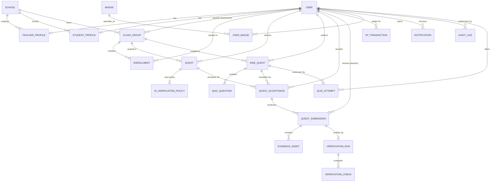

# Ecosphere — Data Model & ERD

**Reference:** PRD v1.0 · SRS v1.0
**DB:** PostgreSQL 15+ with **PostGIS** extension. ORM: **Prisma** (with `@prisma/extension` for raw geo queries via a PostGIS adapter layer).
**Naming:** `snake_case` tables/columns in Postgres; Prisma maps to `snake_case` via `@@map`.

---

## 1. Conventions

| Concern | Rule |
|---|---|
| Primary keys | `id uuid DEFAULT gen_random_uuid()` |
| Timestamps | `created_at`, `updated_at` (`timestamptz`, default `now()`) on every table |
| Soft delete | `archived_at timestamptz null` (preferred over hard delete) |
| Geolocation | `geometry(Point, 4326)` stored via PostGIS; never float lat/lng for querying |
| Enums | PostgreSQL native `ENUM` types for closed sets (see per-table) |
| Money/XP | `bigint` (XP) / `numeric` where needed; no floating-point for rewards |
| Indexes | Named `ix_<table>_<cols>`; spatial index `gix_<table>_location` |
| Constraints | Named; `ux_` for unique, `fk_` for foreign keys |

---

## 2. ERD



---

## 3. Table Specifications

### 3.1 `users`

| Column | Type | Constraints | Notes |
|---|---|---|---|
| id | uuid | PK | |
| email | citext | `ux_users_email` UNIQUE NOT NULL | `citext` = case-insensitive |
| password_hash | text | NOT NULL | bcrypt/argon2 |
| first_name | varchar(100) | NOT NULL | |
| last_name | varchar(100) | NOT NULL | |
| avatar_url | text | NULL | Cloudinary URL |
| role | `user_role` enum | NOT NULL | `ADMIN`, `TEACHER`, `STUDENT` |
| status | `user_status` enum | NOT NULL DEFAULT 'ACTIVE' | `PENDING_APPROVAL`, `ACTIVE`, `SUSPENDED`, `BANNED` |
| consent_given | boolean | NOT NULL DEFAULT false | parental/institutional consent |
| last_login_at | timestamptz | NULL | |
| created_at | timestamptz | NOT NULL DEFAULT now() | |
| updated_at | timestamptz | NOT NULL DEFAULT now() | |
| archived_at | timestamptz | NULL | soft delete |

**Indexes:** `ix_users_status_role(status, role)`; `ix_users_archived(archived_at)`.

### 3.2 `teacher_profiles`

| Column | Type | Constraints | Notes |
|---|---|---|---|
| id | uuid | PK | |
| user_id | uuid | `ux_teacher_profiles_user` UNIQUE, FK→users.id | |
| school_id | uuid | FK→schools.id | nullable until school approved |
| phone | varchar(20) | NULL | |
| bio | text | NULL | |
| verification_status | `verification_status` enum | NOT NULL DEFAULT 'PENDING' | `PENDING`, `APPROVED`, `REJECTED` |
| approved_by | uuid | FK→users.id NULL | admin |
| approved_at | timestamptz | NULL | |

### 3.3 `student_profiles`

| Column | Type | Constraints | Notes |
|---|---|---|---|
| id | uuid | PK | |
| user_id | uuid | `ux_student_profiles_user` UNIQUE, FK→users.id | |
| school_id | uuid | FK→schools.id NULL | |
| grade | varchar(20) | NULL | e.g. "Grade 9" |
| streak_count | integer | NOT NULL DEFAULT 0 | |
| last_activity_date | date | NULL | drives streak reset |
| privacy_mode | boolean | NOT NULL DEFAULT false | hides rank from others (GDPR-K) |

### 3.4 `schools`

| Column | Type | Constraints | Notes |
|---|---|---|---|
| id | uuid | PK | |
| name | varchar(200) | NOT NULL | |
| city | varchar(100) | NULL | |
| state | varchar(100) | NULL | |
| country | varchar(100) | NOT NULL | |
| address | text | NULL | |
| contact_email | citext | NULL | |
| status | `school_status` enum | NOT NULL DEFAULT 'ACTIVE' | `ACTIVE`, `SUSPENDED` |
| created_at / updated_at / archived_at | | standard | |

### 3.5 `class_groups`

| Column | Type | Constraints | Notes |
|---|---|---|---|
| id | uuid | PK | |
| school_id | uuid | FK→schools.id NOT NULL | |
| teacher_id | uuid | FK→users.id NOT NULL | homeroom teacher |
| name | varchar(100) | NOT NULL | "Grade 7 A" |
| join_code | varchar(8) | `ux_class_groups_join_code` UNIQUE NOT NULL | 6–8 char, case-insensitive |
| archived_at | timestamptz | NULL | |

**Indexes:** `ix_class_groups_teacher(teacher_id)`.

### 3.6 `enrollments`

| Column | Type | Constraints | Notes |
|---|---|---|---|
| id | uuid | PK | |
| class_group_id | uuid | FK→class_groups.id NOT NULL | |
| student_id | uuid | FK→users.id NOT NULL | student user |
| enrolled_at | timestamptz | NOT NULL DEFAULT now() | |
| left_at | timestamptz | NULL | |

**Uniques:** `ux_enrollments_class_student(class_group_id, student_id)`.

### 3.7 `quests` (Main Quests)

| Column | Type | Constraints | Notes |
|---|---|---|---|
| id | uuid | PK | |
| teacher_id | uuid | FK→users.id NOT NULL | |
| class_group_id | uuid | FK→class_groups.id NULL | NULL = public/global |
| title | varchar(150) | NOT NULL | |
| description | text | NOT NULL | |
| category | `quest_category` enum | NOT NULL | `TREE_PLANTATION`, `WASTE_COLLECTION`, `PARK_CLEANING`, `RECYCLING`, `BIODIVERSITY`, `AWARENESS`, `OTHER` |
| difficulty | `quest_difficulty` enum | NOT NULL DEFAULT 'EASY' | `EASY`, `MEDIUM`, `HARD`, `EXPERT` |
| xp_reward | bigint | NOT NULL | validated ≤ admin cap |
| location | `geometry(Point,4326)` | NOT NULL | PostGIS |
| address_text | text | NULL | reverse geocoded display |
| radius_meters | integer | NOT NULL | 10–1000 m |
| starts_at | timestamptz | NOT NULL | |
| ends_at | timestamptz | NOT NULL | deadline |
| max_participants | integer | NULL | |
| required_proof_type | `proof_type` enum | NOT NULL DEFAULT 'PHOTO' | `PHOTO`, `VIDEO`, `PHOTO_AND_VIDEO` |
| min_photo_count | integer | NOT NULL DEFAULT 1 | |
| policy_id | uuid | FK→ai_verification_policies.id NULL | NULL → default policy |
| status | `quest_status` enum | NOT NULL DEFAULT 'DRAFT' | `DRAFT`, `PUBLISHED`, `ACTIVE`, `EXPIRED`, `CANCELLED`, `ARCHIVED` |
| published_at | timestamptz | NULL | |
| created_at / updated_at | | standard | |

**Indexes:**
- `gix_quests_location` **GIST** on `location`
- `ix_quests_status_dates(status, starts_at, ends_at)`
- `ix_quests_class(class_group_id, status)`
- `ix_quests_teacher(teacher_id, status)`

**Check constraints:** `ends_at > starts_at`; `radius_meters BETWEEN 10 AND 1000`.

### 3.8 `side_quests`

| Column | Type | Constraints | Notes |
|---|---|---|---|
| id | uuid | PK | |
| teacher_id | uuid | FK→users.id NOT NULL | |
| class_group_id | uuid | FK→class_groups.id NULL | NULL = public |
| title | varchar(150) | NOT NULL | |
| description | text | NULL | |
| type | `side_quest_type` enum | NOT NULL | `QUIZ`, `ESSAY`, `POSTER`, `PRESENTATION`, `VIDEO`, `ANIMATION`, `RESEARCH` |
| content | jsonb | NOT NULL | quiz Q&A / prompt / rubric / resources |
| xp_reward | bigint | NOT NULL | |
| pass_threshold | integer | NULL | % score for QUIZ |
| due_at | timestamptz | NULL | |
| status | `quest_status` enum | NOT NULL DEFAULT 'DRAFT' | shared enum |
| created_at / updated_at / archived_at | | standard | |

### 3.9 `quiz_questions`

| Column | Type | Constraints | Notes |
|---|---|---|---|
| id | uuid | PK | |
| side_quest_id | uuid | FK→side_quests.id NOT NULL | |
| position | integer | NOT NULL | ordering |
| prompt | text | NOT NULL | |
| options | jsonb | NOT NULL | array of strings |
| correct_index | integer | NOT NULL | never returned to client |
| explanation | text | NULL | shown after answering |

### 3.10 `ai_verification_policies`

| Column | Type | Constraints | Notes |
|---|---|---|---|
| id | uuid | PK | |
| name | varchar(100) | NOT NULL | |
| enabled_checks | `verification_check_type[]` | NOT NULL | which checks run |
| thresholds | jsonb | NOT NULL | per-check thresholds (confidence, distance, etc.) |
| auto_approve_enabled | boolean | NOT NULL DEFAULT true | |
| auto_approve_min_confidence | numeric(4,3) | NOT NULL DEFAULT 0.95 | |
| auto_reject_enabled | boolean | NOT NULL DEFAULT false | |
| auto_reject_min_confidence | numeric(4,3) | NOT NULL DEFAULT 0.99 | |
| is_default | boolean | NOT NULL DEFAULT false | |
| created_at / updated_at | | standard | |

### 3.11 `quest_acceptances`

| Column | Type | Constraints | Notes |
|---|---|---|---|
| id | uuid | PK | |
| quest_id | uuid | FK→quests.id NULL | exactly one of quest/side_quest |
| side_quest_id | uuid | FK→side_quests.id NULL | |
| student_id | uuid | FK→users.id NOT NULL | |
| accepted_at | timestamptz | NOT NULL DEFAULT now() | |
| status | `acceptance_status` enum | NOT NULL DEFAULT 'ACCEPTED' | `ACCEPTED`, `IN_PROGRESS`, `SUBMITTED`, `APPROVED`, `REJECTED`, `EXPIRED` |
| completed_at | timestamptz | NULL | |
| xp_awarded | bigint | NOT NULL DEFAULT 0 | |
| bonus_xp | bigint | NOT NULL DEFAULT 0 | |
| is_archived | boolean | NOT NULL DEFAULT false | |

**Uniques:** `ux_acceptances_quest_student(quest_id, student_id)`, `ux_acceptances_side_student(side_quest_id, student_id)`.
**Check:** `(quest_id IS NULL) <> (side_quest_id IS NULL)`.
**Indexes:** `ix_acceptances_student(student_id, status)`.

### 3.12 `quest_submissions`

| Column | Type | Constraints | Notes |
|---|---|---|---|
| id | uuid | PK | |
| acceptance_id | uuid | FK→quest_acceptances.id NOT NULL | |
| submitted_at | timestamptz | NOT NULL DEFAULT now() | server clock |
| device_timestamp | timestamptz | NULL | client clock |
| location | `geometry(Point,4326)` | NOT NULL | GPS at upload |
| location_accuracy_m | integer | NULL | |
| notes | text | NULL | |
| status | `submission_status` enum | NOT NULL DEFAULT 'PENDING_VERIFICATION' | `PENDING_VERIFICATION`, `PENDING_MANUAL_REVIEW`, `AUTO_APPROVED`, `AUTO_REJECTED`, `APPROVED`, `REJECTED` |
| reviewed_by | uuid | FK→users.id NULL | teacher |
| reviewed_at | timestamptz | NULL | |
| review_note | text | NULL | teacher note / rejection reason |
| bonus_xp | bigint | NOT NULL DEFAULT 0 | teacher-awarded |
| re_submission_of | uuid | FK→quest_submissions.id NULL | chain for re-submissions |

**Indexes:**
- `gix_quest_submissions_location` GIST
- `ix_quest_submissions_status(status, reviewed_by)` — review queue
- `ix_quest_submissions_acceptance(acceptance_id)`

### 3.13 `evidence_assets`

| Column | Type | Constraints | Notes |
|---|---|---|---|
| id | uuid | PK | |
| submission_id | uuid | FK→quest_submissions.id NOT NULL | |
| asset_type | `asset_type` enum | NOT NULL | `IMAGE`, `VIDEO` |
| cloudinary_public_id | varchar(255) | NOT NULL | |
| secure_url | text | NOT NULL | |
| mime_type | varchar(100) | NOT NULL | allowlist enforced |
| size_bytes | bigint | NOT NULL | |
| width / height | integer | NULL | |
| exif_gps | `geometry(Point,4326)` | NULL | EXIF-derived |
| exif_taken_at | timestamptz | NULL | |
| exif_raw | jsonb | NULL | minimal retained set |
| perceptual_hash | bigint | NULL | phash (dHash/aHash 64-bit) for dup detection |
| uploaded_at | timestamptz | NOT NULL DEFAULT now() | |

**Indexes:** `ix_evidence_assets_hash(perceptual_hash)`; `ix_evidence_assets_submission(submission_id)`.

### 3.14 `verification_runs`

| Column | Type | Constraints | Notes |
|---|---|---|---|
| id | uuid | PK | |
| submission_id | uuid | `ux_verification_runs_submission` UNIQUE, FK→quest_submissions.id | 1:1 |
| status | `run_status` enum | NOT NULL DEFAULT 'PENDING' | `PENDING`, `RUNNING`, `COMPLETED`, `FAILED` |
| started_at / completed_at | timestamptz | NULL | |
| overall_recommendation | `recommendation` enum | NULL | `APPROVE`, `REJECT`, `NEEDS_MANUAL_REVIEW` |
| overall_confidence | numeric(4,3) | NULL | |
| fraud_risk | `fraud_risk` enum | NULL | `LOW`, `MEDIUM`, `HIGH` |
| summary | text | NULL | human-readable AI summary |
| ai_service_version | varchar(50) | NULL | |
| error_message | text | NULL | on FAILED |
| attempt_count | integer | NOT NULL DEFAULT 0 | retry tracking |

### 3.15 `verification_checks`

| Column | Type | Constraints | Notes |
|---|---|---|---|
| id | uuid | PK | |
| run_id | uuid | FK→verification_runs.id NOT NULL | |
| check_type | `verification_check_type` enum | NOT NULL | `GPS_PROXIMITY`, `TIMESTAMP_FRESHNESS`, `EXIF_METADATA`, `EXIF_GPS_CONSISTENCY`, `IMAGE_SIMILARITY`, `OBJECT_DETECTION`, `SCENE_CLASSIFICATION`, `DUPLICATE_DETECTION`, `IMAGE_QUALITY`, `DEVICE_SPOOFING` |
| status | `check_status` enum | NOT NULL | `PASS`, `FAIL`, `WARN`, `SKIP` |
| score | numeric(6,3) | NULL | normalized 0–1 or raw metric |
| confidence | numeric(4,3) | NULL | |
| message | text | NULL | |
| details | jsonb | NULL | distances, detections, hashes |
| **Uniques** | | | `ux_verification_checks_run_type(run_id, check_type)` |

### 3.16 `xp_transactions`

| Column | Type | Constraints | Notes |
|---|---|---|---|
| id | uuid | PK | |
| user_id | uuid | FK→users.id NOT NULL | |
| source_type | `xp_source` enum | NOT NULL | `QUEST_COMPLETION`, `SIDE_QUEST_COMPLETION`, `QUIZ`, `BONUS`, `BADGE`, `STREAK`, `ADMIN_ADJUSTMENT`, `MANUAL` |
| source_id | uuid | NULL | FK to quest/submission/badge as applicable |
| amount | bigint | NOT NULL | positive or negative (adjustments) |
| balance_after | bigint | NOT NULL | running total for auditability |
| note | text | NULL | |
| created_at | timestamptz | NOT NULL DEFAULT now() | |

**Indexes:** `ix_xp_transactions_user_created(user_id, created_at DESC)`; `ix_xp_transactions_source(source_type, source_id)`.

### 3.17 `badges`

| Column | Type | Constraints | Notes |
|---|---|---|---|
| id | uuid | PK | |
| key | varchar(50) | `ux_badges_key` UNIQUE NOT NULL | stable slug, e.g. `xp_500` |
| name | varchar(100) | NOT NULL | |
| description | text | NOT NULL | |
| icon_url | text | NOT NULL | |
| category | `badge_category` enum | NOT NULL | `XP`, `QUEST_COUNT`, `CATEGORY`, `STREAK`, `CONSISTENCY`, `SPECIAL` |
| criteria_type | `badge_criteria` enum | NOT NULL | `XP_THRESHOLD`, `QUEST_COUNT`, `CATEGORY_COUNT`, `STREAK_LENGTH`, `ACTIVITY_WEEKS`, `MANUAL` |
| criteria_value | jsonb | NOT NULL | `{threshold: 500}` etc. |
| xp_bonus | bigint | NOT NULL DEFAULT 0 | awarded with badge |
| is_active | boolean | NOT NULL DEFAULT true | |

### 3.18 `user_badges`

| Column | Type | Constraints | Notes |
|---|---|---|---|
| id | uuid | PK | |
| user_id | uuid | FK→users.id NOT NULL | |
| badge_id | uuid | FK→badges.id NOT NULL | |
| earned_at | timestamptz | NOT NULL DEFAULT now() | |
| **Unique** | | | `ux_user_badges_user_badge(user_id, badge_id)` |

### 3.19 `notifications`

| Column | Type | Constraints | Notes |
|---|---|---|---|
| id | uuid | PK | |
| user_id | uuid | FK→users.id NOT NULL | |
| type | `notification_type` enum | NOT NULL | `QUEST_NEW`, `QUEST_EXPIRING`, `SUBMISSION_VERIFIED`, `SUBMISSION_REVIEWED`, `BADGE_EARNED`, `LEVEL_UP`, `XP_EARNED`, `SYSTEM`, `MANUAL` |
| title | varchar(200) | NOT NULL | |
| body | text | NULL | |
| payload | jsonb | NULL | deep-link data |
| is_read | boolean | NOT NULL DEFAULT false | |
| created_at | timestamptz | NOT NULL DEFAULT now() | |

**Indexes:** `ix_notifications_user_created(user_id, created_at DESC)`; partial `ix_notifications_unread(user_id) WHERE is_read = false`.

### 3.20 `xp_settings`

| Column | Type | Constraints | Notes |
|---|---|---|---|
| id | uuid | PK | |
| key | varchar(100) | `ux_xp_settings_key` UNIQUE NOT NULL | `xp_band.EASY` etc. |
| label | varchar(150) | NOT NULL | |
| value | jsonb | NOT NULL | typed config |
| description | text | NULL | |
| updated_by | uuid | FK→users.id NULL | admin |
| updated_at | timestamptz | NOT NULL DEFAULT now() | |

### 3.21 `quiz_attempts`

| Column | Type | Constraints | Notes |
|---|---|---|---|
| id | uuid | PK | |
| side_quest_id | uuid | FK→side_quests.id NOT NULL | |
| student_id | uuid | FK→users.id NOT NULL | |
| score | integer | NOT NULL | |
| max_score | integer | NOT NULL | |
| passed | boolean | NOT NULL | |
| answers | jsonb | NOT NULL | `[{questionId, selectedIndex}]` |
| submitted_at | timestamptz | NOT NULL DEFAULT now() | |
| **Unique** | | | `ux_quiz_attempts_user_quest(student_id, side_quest_id)` (single retry only if teacher re-opens) |

### 3.22 `audit_logs`

| Column | Type | Constraints | Notes |
|---|---|---|---|
| id | uuid | PK | |
| user_id | uuid | FK→users.id NULL | actor (system ops → NULL) |
| action | varchar(100) | NOT NULL | `user.approve_teacher`, `quest.publish`, `submission.approve`, `xp.adjust` … |
| entity_type | varchar(50) | NOT NULL | |
| entity_id | uuid | NOT NULL | |
| meta | jsonb | NULL | before/after diff, ip, ua |
| ip_address | inet | NULL | |
| created_at | timestamptz | NOT NULL DEFAULT now() | |

**Indexes:** `ix_audit_logs_created(created_at)`; `ix_audit_logs_entity(entity_type, entity_id)`.
**Note:** append-only — no UPDATE/DELETE grant to application role.

---

## 4. PostGIS / Spatial Strategy

1. `location` columns are `geometry(Point,4326)` (not `geography`) for predictable WGS-84 semantics; use `ST_DWithin(geog, geog, radius)` casts for metric distances.
2. Quest discovery query:
   ```sql
   SELECT q.*,
          ST_Distance(q.location::geography, ST_SetSRID(ST_MakePoint($lng,$lat),4326)::geography) AS distance_m
   FROM quests q
   WHERE q.status = 'ACTIVE'
     AND q.starts_at <= now() AND q.ends_at > now()
     AND ST_DWithin(q.location::geography, ST_SetSRID(ST_MakePoint($lng,$lat),4326)::geography, $maxRadiusM)
   ORDER BY distance_m;
   ```
3. Submission radius enforcement (server-side, fraud-critical):
   ```sql
   SELECT ST_Distance(q.location::geography, $subLoc::geography) <= q.radius_meters
   FROM quests q WHERE q.id = $questId;
   ```
4. GIST indexes on all geometry columns; no functional-expression traps (keep `ST_SetSRID` params as bind values, not column expressions).

## 5. Enums (closed sets)

`user_role`, `user_status`, `verification_status`, `school_status`, `quest_category`, `quest_difficulty`, `proof_type`, `quest_status`, `side_quest_type`, `acceptance_status`, `submission_status`, `asset_type`, `run_status`, `recommendation`, `fraud_risk`, `verification_check_type`, `check_status`, `xp_source`, `badge_category`, `badge_criteria`, `notification_type`.

---

## 6. Anti-Fraud / Data Integrity Notes

- `quest_acceptances` uniqueness prevents double-accept / double-reward.
- XP awarded inside the same transaction as `submission.status = 'APPROVED'` — atomic, idempotent via acceptance `xp_awarded` flag.
- `evidence_assets.perceptual_hash` enables duplicate detection: query recent approved assets by hamming distance ≤ threshold.
- `audit_logs` append-only; application DB role lacks UPDATE/DELETE on this table.
- Soft-delete everywhere; hard deletes only in maintenance scripts after legal retention windows.

## 7. Migration Path → Prisma

- Native enums map to Prisma `enum` types.
- `geometry` handled by a thin PostGIS abstraction (raw `$queryRaw`/`$executeRaw` for spatial ops) — Prisma has no native geometry type.
- All unique/index names mirrored as `@@unique`, `@@index` to keep migrations deterministic.
